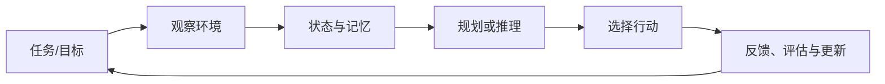
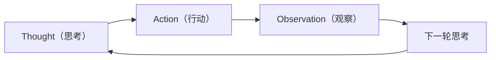
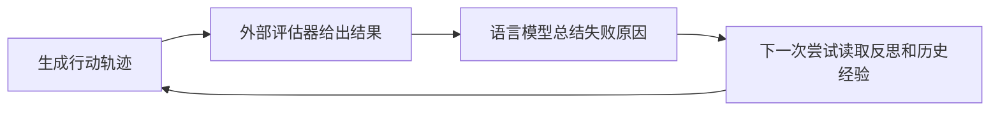

LLM 很擅长根据上下文生成文本，但一次性的文本生成并不等于完成任务。面对需要搜索资料、调用工具、分解步骤、记住历史、根据结果修正方案的复杂问题，模型必须能够持续感知环境、做出行动，并根据反馈调整自己。Agent 研究因此关注模型如何围绕任务目标持续行动，并利用环境反馈调整后续步骤。

本笔记选择五篇代表性论文，沿着 Agent 能力逐步扩展的路径展开：**ReAct** 关注推理与行动如何交替，**Toolformer** 关注模型如何学会调用外部工具，**Generative Agents** 把记忆、反思与社会行为引入持续运行的环境，**Reflexion** 让 Agent 依据语言化反馈自我改进，**AutoGen** 则进一步探讨多个 Agent 如何协作。结合这些论文，可以了解推理、工具调用、记忆、纠错和协作机制如何构成 Agent 系统。

## 一、先建立一个统一的 Agent 视角

可以把一个 LLM Agent 抽象成如下闭环：

其中最关键的组成部分是：

* **推理（reasoning）** ：把复杂目标拆成中间步骤，并说明下一步为什么这样做；
* **行动（acting）** ：调用搜索、计算器、数据库、代码执行器或环境接口；
* **观察（observation）** ：读取工具返回值或环境的新状态；
* **记忆（memory）** ：保存当前上下文、历史经历和可复用知识；
* **反馈（feedback）** ：判断结果是否正确，并据此继续、修正或重试；
* **协作（coordination）** ：把任务分给不同角色或不同 Agent。

普通问答通常通过一次文本生成给出回答。Agent 则需要在约束条件下多次调用模型或工具，并根据反馈继续执行任务。因此，系统还需要确定行动时机、检查行动安全性、处理错误、控制成本，并设置终止条件。

## 二、ReAct：把推理和行动放进同一个循环

论文：[ReAct: Synergizing Reasoning and Acting in Language Models](https://arxiv.org/abs/2210.03629v3)

### 2.1 研究动机

Chain-of-Thought 让模型生成中间推理步骤，但推理过程通常与外部世界隔离，容易因为事实错误而一路推错。另一方面，传统的行动式任务方法可以和环境交互，却缺少可解释的高层计划。ReAct 的核心判断是：**推理和行动应当交替进行，并且互相提供信息。**

### 2.2 核心范式

ReAct 使用一种交替轨迹：

例如在开放域问答中，模型先判断需要查找某个实体，再调用搜索工具；获得搜索结果后，模型根据新证据继续推理。思考步骤负责拆解问题、追踪当前状态和决定行动，行动步骤负责改变环境或查询信息，观察步骤把真实返回值重新注入上下文。

论文主要通过少量示例进行提示学习，而不是为每个任务训练一个新的策略。它在知识问答和事实核验任务中使用搜索 API，在 ALFWorld、WebShop 等交互环境中使用环境动作。

### 2.3 重要结论

* 对需要外部知识的任务，行动可以减少模型凭空编造；
* 对需要多步决策的任务，显式的中间思考有助于保持目标和状态；
* 纯 CoT 和纯行动策略各有缺陷，交替机制能兼顾可解释推理与环境反馈；
* 错误观察可以暴露在轨迹中，使模型有机会修正，而不是把错误隐藏在一次性答案里。

### 2.4 局限

ReAct 不等于可靠的自主规划器。它依赖提示示例，长轨迹会增加上下文和调用成本；模型可能产生无效动作、重复搜索或在错误方向上继续推理。思考文本本身也不保证真实反映模型内部过程。因此，工程系统仍需要工具参数校验、超时、重试、预算和终止条件。

## 三、Toolformer：学习工具选择与调用时机

论文：[Toolformer: Language Models Can Teach Themselves to Use Tools](https://arxiv.org/abs/2302.04761v1)

### 3.1 研究动机

ReAct 主要依赖人工设计的提示模板。Toolformer 则研究如何通过训练，使语言模型学会选择调用时机、生成调用参数，并利用工具返回结果预测后续文本。

### 3.2 训练流程

Toolformer 从一个已经具备语言能力的模型开始，使用少量人工编写的 API 调用示例作为种子。随后模型自动生成可能的 API 调用位置和参数，并执行这些调用获得结果。只有在工具结果确实降低后续文本预测损失时，调用样本才会被保留。最后，模型在混合了普通文本和 API 调用标记的数据上进行微调。

这个过程采用 **自监督的调用筛选** ：用语言建模损失衡量调用是否有帮助，无需人工逐条标注调用位置。论文实验涉及计算器、搜索、问答、翻译和日历等工具，结果表明模型可以在保持通用语言能力的同时获得工具使用能力。

### 3.3 和 ReAct 的区别

ReAct 更像一个由提示驱动的运行时控制循环，思考和行动以显式文本轨迹出现；Toolformer 更关注训练阶段，让模型在生成过程中自主插入工具调用。前者强调可解释的过程控制，后者强调调用策略的内化。实际系统可以组合二者：用 ReAct 或工作流约束运行时，用 Toolformer 所代表的思想训练或优化调用选择器。

### 3.4 局限和启示

工具结果质量直接影响训练样本质量；API 错误、延迟、费用和安全问题在论文中的简化实验里体现得较少。真实应用中，工具应有清晰的 schema、权限边界和错误返回格式。即使模型具备工具调用能力，高风险操作仍需要权限检查和执行限制。

## 四、Generative Agents：记忆、反思和计划支撑持续行为

论文：[Generative Agents: Interactive Simulacra of Human Behavior](https://arxiv.org/abs/2304.03442)

### 4.1 研究问题

一次问答只需处理当前上下文，而生活模拟中的 Agent 需要记住过去、形成偏好、安排未来，并对其他角色作出连贯回应。Generative Agents 在一个类似小镇的模拟环境中部署 25 个 Agent，研究如何让它们产生具有社会性的长期行为。

### 4.2 三个核心模块

 **记忆流（memory stream）** ：把 Agent 的观察、行动和对话记录成带时间戳的自然语言事件。每次需要行动时，从记忆流中检索相关内容，而不是把所有历史都塞进上下文。

 **记忆检索（retrieval）** ：论文综合考虑近期性、重要性和相关性。近期事件更容易被想起，重要事件优先级更高，与当前目标语义相关的事件也更容易被取出。这说明记忆不是简单的日志，而是一个带有检索策略的状态模块。

 **反思（reflection）** ：当积累了足够多的事件后，Agent 从这些事件中归纳角色偏好、行为规律等信息，再把反思结果写回记忆流。

此外，Agent 会根据当前状态和记忆生成日程，并在执行过程中动态调整计划。论文展示了从个体行动到群体涌现现象的案例，例如信息传播、社交邀约和活动组织。

### 4.3 重要启示

* 长期一致性不能只靠更大的上下文窗口，还需要可检索、可压缩的记忆；
* 反思把多个具体事件提升为可复用的高层知识；
* 计划不是一次性生成的静态列表，而应根据新观察不断重规划；
* 社会行为来自多个 Agent 的局部决策和交互，不必由一个中央控制器直接编排。

### 4.4 局限

这是一个小规模、规则较强的模拟环境，行为与人类行为的相似程度主要通过定性案例和人工评价体现。记忆检索、反思频率和重要性评分中的许多参数仍需要人为设定。把这种架构迁移到真实业务时，还要处理隐私、记忆污染、错误信念和长期成本。

## 五、Reflexion：用语言反馈进行自我改进

论文：[Reflexion: Language Agents with Verbal Reinforcement Learning](https://arxiv.org/abs/2303.11366)

### 5.1 核心思想

传统强化学习把反馈编码成数值奖励，并更新模型参数。Reflexion 提出另一条路线：**把任务结果和失败原因转成自然语言反思，存入情景记忆，在下一次尝试时提供给 Agent。** 这被称为 verbal reinforcement learning。

### 5.2 工作循环

系统通常包含三个角色：负责执行任务的 Agent、负责判断结果的 evaluator，以及负责生成反思的 self-reflection 模块。评估可以是测试用例是否通过、答案是否正确或环境奖励是否提升。反思文本记录错误位置、失败原因和下一次尝试的改进策略，提供比单独的 0/1 分数更具体的反馈。

### 5.3 论文贡献

在编程、语言推理和决策任务中，Reflexion 通过多轮尝试和情景记忆提升了成功率。它不需要在每次失败后更新基础模型参数，因此成本低、实现简单，也更容易保留具体任务经验。

### 5.4 关键边界

Reflexion 的改进依赖评估器。如果反馈错误、过于模糊或只评价最终结果，反思可能变成合理化解释，甚至把错误经验写入记忆。实际系统应保存原始轨迹、评估依据和反思版本，并限制记忆的有效范围，避免一次偶然失败永久改变行为。

## 六、AutoGen：把 Agent 组织成可编排的对话系统

论文：[AutoGen: Enabling Next-Gen LLM Applications via Multi-Agent Conversation](https://arxiv.org/abs/2308.08155)

### 6.1 研究动机

复杂任务通常同时需要规划、检索、编码、执行和审查。让一个 Agent 承担所有角色会导致提示复杂、上下文混乱和错误难以定位。AutoGen 提供一个多 Agent 对话框架，把不同能力封装成可对话的 Agent，并通过消息传递完成协作。

### 6.2 基本抽象

AutoGen 中的 Agent 可以有不同配置：

* **Assistant Agent** ：负责规划、解释、生成代码或提出方案；
* **User Proxy Agent** ：代表用户，能够触发人工确认，也可以执行代码；
* **工具或专用 Agent** ：负责检索、数据处理、代码审查等具体工作；
* **群聊管理器** ：决定下一位发言者、控制轮次和结束条件。

Agent 通过统一的消息和自动回复机制协作。典型流程是：一个 Agent 生成代码，代码执行器运行并返回错误，另一个 Agent 根据错误修复代码，最后由审查 Agent 验证结果。人工可以在关键步骤介入，形成 human-in-the-loop。

### 6.3 重要思想

* 多 Agent 协作需要明确各角色的职责和交接条件；
* 对话是一种控制流，可以把规划、执行和审查串成可观察的轨迹；
* 工具执行和 LLM 推理应分离，避免模型直接伪造执行结果；
* 自动回复、终止条件和人工介入策略决定了系统是否可控。

### 6.4 局限

多 Agent 会增加消息数量、延迟和费用，也可能产生循环对话、职责重叠和错误相互放大的问题。实际项目应先用单 Agent 或确定性工作流解决问题，再在确有并行、分工或独立审查需求时引入多 Agent。

## 七、五篇论文的横向比较

| 论文              | 主要解决的问题           | 核心机制                          | 反馈来源                 | 记忆形式             | 系统形态                 |
| ----------------- | ------------------------ | --------------------------------- | ------------------------ | -------------------- | ------------------------ |
| ReAct             | 如何交替进行推理与行动   | Thought–Action–Observation 循环 | 工具或环境观察           | 当前轨迹             | 单 Agent、运行时提示     |
| Toolformer        | 如何自主选择工具         | API 调用生成与损失筛选            | 工具返回值和语言建模损失 | 模型参数中的调用能力 | 单模型、训练时增强       |
| Generative Agents | 如何保持长期、社会化行为 | 记忆流、检索、反思、计划          | 环境事件和社交互动       | 事件记忆与高层反思   | 多个持续运行的模拟 Agent |
| Reflexion         | 如何从失败中改进         | 语言化反馈与情景记忆              | evaluator 或任务奖励     | 反思文本             | 单 Agent、多轮尝试       |
| AutoGen           | 如何完成多角色协作       | 可对话 Agent、自动回复、群聊      | 其他 Agent、工具、人工   | 对话历史和外部状态   | 多 Agent 框架            |

综合这些论文，Agent 的能力取决于模型本身，也受到**控制循环、外部工具、状态记忆、反馈机制和协作协议**的影响。

## 八、贯穿五篇论文的通用架构

可以把一个可落地的 Agent 系统拆成六层：

1. **目标层** ：明确任务、成功标准、权限和预算；
2. **状态层** ：保存当前任务状态、已完成步骤、工具结果和未决问题；
3. **推理与规划层** ：选择下一步，必要时拆分子任务并生成计划；
4. **工具与执行层** ：通过结构化 schema 调用外部 API、代码执行器或环境；
5. **记忆与反馈层** ：保存可复用经验，接受测试、人工或环境反馈，并触发反思；
6. **编排与安全层** ：限制循环、权限、成本、并发、敏感操作和人工确认。

五篇论文分别对这些层提供了代表性答案：ReAct 给出控制循环，Toolformer 给出工具选择的学习思路，Generative Agents 给出长期记忆和计划，Reflexion 给出语言反馈，AutoGen 给出多 Agent 编排。

## 九、从论文到工程实践的设计原则

### 1. 先定义成功条件，再设计 Agent

如果缺少可检查的成功标准，系统就难以判断 Agent 是否完成了任务。编程任务应运行测试，数据任务应校验 schema，检索任务应检查来源，业务流程应记录状态变化。

### 2. 把工具调用做成受约束的接口

工具需要明确参数类型、权限、超时、重试次数和错误格式。高风险操作应要求人工确认，不能仅依赖模型自己判断。

### 3. 记忆要分层并允许失效

当前上下文、短期任务状态、长期事实和反思经验应分开保存。记忆需要来源、时间、置信度和删除策略，否则错误信息会不断被检索和强化。

### 4. 反馈必须可验证

仅要求模型重新思考，不能提供明确的错误依据。测试失败信息、工具错误、引用证据和人工修改可以帮助模型定位问题。反思应据此提出下一次尝试的具体改进措施。

### 5. 控制循环和成本

为每个任务设置最大步数、最大 token、调用预算和超时；记录每一步的输入、输出、工具参数和结果，便于复现和审计。

### 6. 多 Agent 要有清晰的分工

只有当任务确实需要并行、独立视角或专门工具时才拆分 Agent。每增加一个 Agent，就增加一条通信链和一组失败模式。

这五篇论文从不同方面说明了 Agent 系统的组成与运行方式。语言模型负责理解任务和生成内容，工具用于查询信息或执行操作，记忆保存跨步骤和跨任务的信息。系统利用反馈识别错误，并通过编排机制记录执行过程、验证结果和控制终止条件。
