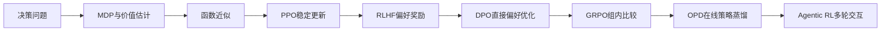
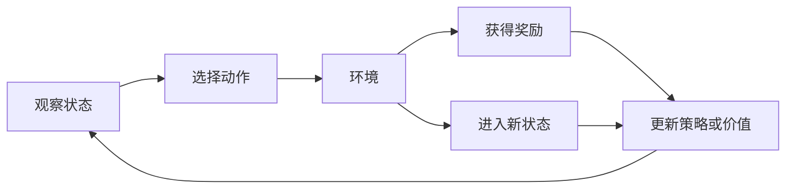
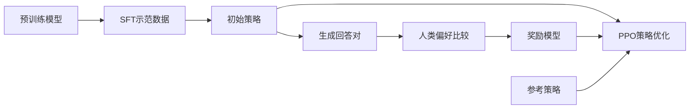
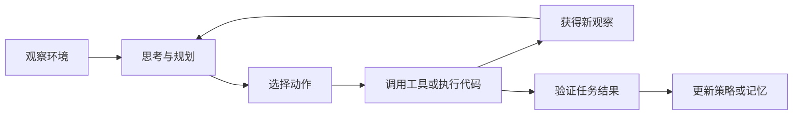

本文根据强化学习课程材料整理，并结合课程备注补充直觉、公式和工程边界。全文围绕一个问题展开：**当我们不知道每一步的标准答案时，如何让智能体通过反馈逐渐学会做出更好的决策？**

AlphaGo 通过对弈改进策略，推理模型通过可验证结果提高解题能力，工具型 Agent 通过环境反馈完成多步任务。它们的任务形态不同，但都涉及状态观察、动作选择和反馈利用；训练时，模型根据反馈更新策略。

## 一、全景导览：强化学习的核心问题与演进路线

强化学习与监督学习的差别，不只是训练数据不同。监督学习直接告诉模型某个输入对应哪个答案；强化学习通常只告诉模型这次结果好不好。模型需要自己探索动作，并把延迟到未来的反馈归因到中间的每一个决策上。

这是一条问题驱动的演进线。每种方法都接手前一种方法留下的难题：

| 遇到的问题                       | 典型方法                  | 核心思路                           |
| -------------------------------- | ------------------------- | ---------------------------------- |
| 已知环境规则，如何求最优决策     | 动态规划                  | 直接利用转移概率和奖励函数迭代价值 |
| 不知道环境模型，如何从经验学习   | MC、TD、Q-learning、SARSA | 从采样轨迹估计回报或价值           |
| 状态空间过大，表格无法存储       | 函数近似、DQN             | 用神经网络泛化到未见状态           |
| 策略更新可能偏离旧数据           | PPO                       | 用重要性比和截断限制单次更新幅度   |
| 好答案难写、偏好较容易比较       | RLHF                      | 用偏好训练奖励模型，再优化策略     |
| 奖励模型和在线训练成本较高       | DPO                       | 在特定 KL 正则目标下直接学习偏好   |
| Critic 成本高，奖励可以验证      | GRPO                      | 用同题回答的组内相对表现估计优势   |
| 终局奖励稀疏、示范分布与学生不同 | OPD                       | 学生采样，教师按 token 提供监督    |
| 目标变成多轮工具任务             | Agentic RL                | 在环境交互中优化完整任务轨迹       |

以上表示问题之间的承接关系，实际系统常把监督微调、偏好优化、在线强化学习和蒸馏组合起来。

## 二、传统强化学习：从 MDP 到价值学习

### 1. 基本交互循环

在时间步 $t$，智能体观察状态 $s_t$，按照策略选择动作 $a_t$。环境返回奖励 $r_{t+1}$，并转移到新状态 $s_{t+1}$。智能体的目标不是最大化眼前奖励，而是最大化长期折扣回报。

延迟是 RL 的根本问题：走迷宫时，通常只有走完整条路后才知道路线是否成功，因此最终结果必须分配给之前的许多动作。

### 2. 马尔可夫决策过程

马尔可夫决策过程（Markov decision process，MDP）通常表示为五元组：

$$
(\mathcal{S},\mathcal{A},P,R,\gamma)
$$

- $\mathcal{S}$：状态集合；
- $\mathcal{A}$：动作集合；
- $P(s'\mid s,a)$：执行动作 $a$ 后转移到 $s'$ 的概率；
- $R(s,a,s')$：转移产生的奖励；
- $\gamma\in[0,1)$：折扣因子。

马尔可夫性要求：给定当前状态和动作，未来不再依赖更早的历史。这里的状态必须包含预测未来所需的信息；如果观测本身不够，就需要把历史或信念状态纳入表示。这个区别在 Agentic RL 中很重要，因为 Agent 通常只能看到环境的一部分。$\gamma$ 越接近 0，策略越看重眼前；越接近 1，策略越重视长期收益，但长回报也更难估计。若奖励有界且 $0\leq\gamma<1$，折扣回报收敛。

策略 $\pi(a\mid s)$ 是状态到动作分布的映射。时刻 $t$ 的折扣回报为：

$$
G_t=\sum_{k=0}^{\infty}\gamma^k r_{t+k+1}
$$

### 3. 价值函数与贝尔曼方程

状态价值函数描述从某个状态出发，遵循策略 $\pi$ 所能获得的预期折扣回报：

$$
V^\pi(s)=\mathbb{E}_\pi[G_t\mid s_t=s]
$$

动作价值函数描述在某个状态下执行指定动作、随后遵循策略 $\pi$ 所能获得的预期折扣回报：

$$
Q^\pi(s,a)=\mathbb{E}_\pi[G_t\mid s_t=s,a_t=a]
$$

由回报的递归结构可以得到贝尔曼期望方程：

$$
V^\pi(s)=\mathbb{E}_\pi\left[r_{t+1}+\gamma V^\pi(s_{t+1})\mid s_t=s\right]
$$

贝尔曼期望方程将当前状态的价值分解为即时奖励与折扣后继状态价值之和的期望。如果 $P$ 和 $R$ 已知，就可以使用动态规划。价值迭代为：

$$
V_{k+1}(s)=\max_a\sum_{s'}P(s'\mid s,a)\left[R(s,a,s')+\gamma V_k(s')\right]
$$

真实环境通常不会提供完整的 $P$ 和 $R$，所以更常见的是无模型学习。

### 4. MC、TD 与 TD 误差

蒙特卡洛（Monte Carlo，MC）方法等回合结束后，用真实回报 $G_t$ 更新价值。它不使用自举，目标直观，但必须等待完整回合，而且回报方差较大。

时序差分（temporal-difference，TD）方法只走一步，就用后继状态的估计值构造目标：

$$
V(s_t)\leftarrow V(s_t)+\alpha\underbrace{\left[r_{t+1}+\gamma V(s_{t+1})-V(s_t)\right]}_{\delta_t}
$$

$\delta_t$ 是 TD 误差，衡量一步 TD 目标与当前价值估计之间的差异。TD 用估计更新估计，所以有自举偏差，但可以在线更新，方差通常更低。n 步方法和 TD($\lambda$) 在一步 TD 与完整 MC 回报之间调节偏差和方差。

| 方法            | 更新目标           | 是否等待回合结束 | 主要取舍               |
| --------------- | ------------------ | ---------------- | ---------------------- |
| MC              | 真实回报$G_t$    | 通常需要         | 无自举偏差，方差较大   |
| TD(0)           | $r+\gamma V(s')$ | 不需要           | 可在线学习，但依赖估计 |
| TD($\lambda$) | 多步 TD 误差加权   | 不需要           | 可调节偏差与方差       |

### 5. Q-learning、SARSA 与探索

Q-learning 使用下一状态下的最大动作价值构造更新目标：

$$
Q(s,a)\leftarrow Q(s,a)+\alpha\left[r+\gamma\max_{a'}Q(s',a')-Q(s,a)\right]
$$

它是 off-policy：即使行为策略还在探索，目标仍使用下一状态下的最大动作价值。SARSA 使用实际执行的下一动作 $a'$：

$$
Q(s,a)\leftarrow Q(s,a)+\alpha\left[r+\gamma Q(s',a')-Q(s,a)\right],\qquad a'\sim\pi
$$

它是 on-policy。两者只差一个 $\max$，但含义不同：Q-learning 假设未来会走最优路线，SARSA 评估当前策略真实会经历的后果。$\max$ 也可能放大估计噪声并造成价值高估；Double DQN 通过在线网络选动作、目标网络评估该动作，缓解这一问题。

探索与利用之间也存在张力。$\varepsilon$-greedy 以概率 $\varepsilon$ 随机探索，否则选择当前最优动作。LLM 中的采样温度和多候选生成有类似作用，但不能简单等同于 $\varepsilon$-greedy。

## 三、深度强化学习：从表格到神经网络

表格法要求逐个访问状态。围棋状态数量约为 $10^{170}$，语言模型的上下文和输出空间更大，因此需要用神经网络近似价值或策略：

$$
V(s)\approx V_\phi(s),\qquad Q(s,a)\approx Q_\phi(s,a),\qquad \pi(a\mid s)\approx\pi_\theta(a\mid s)
$$

函数近似带来泛化，也带来不稳定：更新一个参数会同时改变许多状态的估计。

### 1. DQN

DQN 通过两个技巧稳定训练：经验回放把连续样本打散；目标网络用慢速更新的参数 $\phi^-$ 计算 TD 目标。

$$
\mathcal{L}(\phi)=\mathbb{E}\left[\left(r+\gamma\max_{a'}Q_{\phi^-}(s',a')-Q_\phi(s,a)\right)^2\right]
$$

经验回放从缓冲区随机抽取样本，减弱相邻状态带来的时间相关性；目标网络以冻结或缓慢同步的参数计算 TD 目标，避免预测目标随每次更新一起移动。Double DQN 用在线网络选择下一动作、目标网络评估该动作，以缓解 $\max$ 的高估；Dueling DQN 分开建模状态价值和动作优势。DQN 的关键思想是让监督目标在一段时间内保持稳定。

### 2. 策略梯度与 Actor-Critic

策略梯度直接优化策略 $\pi_\theta$。对回报较高的动作，提高其对数概率的方向会得到更大的权重：

$$
\nabla_\theta J(\theta)\approx\mathbb{E}_{\tau\sim\pi_\theta}\left[\sum_t\nabla_\theta\log\pi_\theta(a_t\mid s_t)G_t\right]
$$

这个形式来自似然比技巧，使梯度可以通过采样轨迹估计。

为了降低方差，常用优势函数：

$$
A^\pi(s,a)=Q^\pi(s,a)-V^\pi(s)
$$

优势函数衡量指定动作的预期回报相对于当前策略在该状态下平均预期回报的差异。Actor 负责选择动作，Critic 负责估计状态价值。Critic 给出的优势通常由 $Q-V$ 表示；实际算法也会用 TD 误差近似优势。基线能在适当条件下不改变策略梯度的期望，同时降低方差，但需要额外训练价值网络，增加显存和调参成本。

### 3. LLM 中的序列决策

| RL 概念            | LLM 中的对应              |
| ------------------ | ------------------------- |
| 状态$s_t$        | prompt 与此前生成的 token |
| 动作$a_t$        | 选择下一个 token          |
| 策略$\pi_\theta$ | 语言模型的条件分布        |
| 回合               | 一次完整生成              |
| 奖励               | 偏好、规则验证或环境结果  |

## 四、PPO：如何稳定地更新策略

朴素策略梯度没有步长保护。一次过大的更新可能让新策略远离采样数据对应的旧策略，之后再也采不到好样本。

重要性采样比为：

$$
r_t(\theta)=\frac{\pi_\theta(a_t\mid s_t)}{\pi_{\mathrm{old}}(a_t\mid s_t)}
$$

PPO-Clip 的目标为：

$$
L^{\mathrm{CLIP}}(\theta)=\mathbb{E}_t\left[\min\left(r_t(\theta)A_t,\operatorname{clip}(r_t(\theta),1-\varepsilon,1+\varepsilon)A_t\right)\right]
$$

当 $A_t>0$ 时，提高该动作概率有利，但超过 $1+\varepsilon$ 后不再继续奖励；当 $A_t<0$ 时，过度降低概率也不会继续获得收益。PPO 的 clip 是软约束：它会让目标对超出区间的概率比不再持续提供同方向的收益，但不保证所有概率比都留在区间内，也不保证 KL 距离严格低于某个阈值。实践中仍需监控 KL，必要时提前停止更新。

GAE 把多个 TD 误差加权起来估计优势：

$$
\delta_t=r_{t+1}+\gamma V(s_{t+1})-V(s_t)
$$

$$
\hat A_t^{\mathrm{GAE}(\gamma,\lambda)}=\sum_{l=0}^{\infty}(\gamma\lambda)^l\delta_{t+l}
$$

$\lambda=0$ 接近一步 TD；$\lambda$ 越接近 1，越接近完整回报。PPO 的典型流程是：采样轨迹，计算优势和价值目标，再对同一批数据做若干轮小批量更新。重复利用数据提高了样本效率，也使更新偏离采样策略的风险更突出，因此 clip、KL 监控和更新轮数需要一起考虑。

## 五、RLHF：把人类偏好变成奖励

预训练使模型学习语言规律和知识，SFT 通过示范数据训练模型遵循指令，其效果受示范质量和覆盖范围影响。对于难以给出标准答案的任务，比较两个回答的质量通常更容易，因此 RLHF 使用偏好比较提供训练信号。

Bradley–Terry 偏好模型为：

$$
P(y_w\succ y_l\mid x)=\sigma\left(r_\psi(x,y_w)-r_\psi(x,y_l)\right)
$$

策略优化可以写成：

$$
\max_\pi\;\mathbb{E}_{x,y\sim\pi}[r_\psi(x,y)]-\beta D_{\mathrm{KL}}\left(\pi(\cdot\mid x)\middle\|\pi_{\mathrm{ref}}(\cdot\mid x)\right)
$$

KL 项用于限制策略偏离参考分布的程度，但不能保证系统安全。奖励模型若存在漏洞，策略可能利用这些漏洞获得高分，因此仍需独立评估和对抗测试。标准 PPO-RLHF 的工程成本也较高，通常涉及策略、Critic、奖励模型和参考模型。

## 六、DPO：绕过显式奖励模型

DPO 利用 KL 正则化奖励优化问题的特定闭式关系，将奖励表示为策略相对参考策略的对数概率差，再直接训练偏好对：

$$
\begin{aligned}
L_{\mathrm{DPO}}(\theta)=-\mathbb{E}\log\sigma\Bigl(\beta[&\log\pi_\theta(y_w\mid x)-\log\pi_{\mathrm{ref}}(y_w\mid x)\\
&-\log\pi_\theta(y_l\mid x)+\log\pi_{\mathrm{ref}}(y_l\mid x)]\Bigr)
\end{aligned}
$$

它表达相对于参考策略提高偏好回答的概率，并降低不偏好回答的相对概率。推导中的归一化项只依赖 prompt，在同一 prompt 的两个回答相减时会抵消。DPO 通常不需要单独训练奖励模型、Critic 或在线 rollout，因此训练流程更接近离线分类；但参考策略仍出现在目标中。

DPO 中的奖励与最优策略关系依赖特定的 KL 正则目标、偏好模型和参考策略，不能推广为任意奖励与任意策略之间的一一对应。它还依赖离线数据覆盖；当前模型远离训练分布时，偏好信号可能不足。即使偏好回答的相对概率提高，两类回答的绝对概率也可能同时下降，因此还要检查输出质量和分布变化。

## 七、GRPO：用组内比较替代 Critic

Critic 需要额外的同规模价值网络，却常常只能从整句奖励反推每个 token 的价值。GRPO 对同一个问题 $q$ 采样 $G$ 个回答，用组内奖励的相对位置构造优势：

$$
\hat A_i=\frac{r_i-\operatorname{mean}(r_1,\ldots,r_G)}{\operatorname{std}(r_1,\ldots,r_G)+\epsilon}
$$

组内平均奖励作为基线：奖励高于均值的回答得到正优势，低于均值的回答得到负优势。GRPO 的其余优化结构仍接近 PPO，包括重要性比、clip 和 KL 约束。

GRPO 特别适合数学、代码等可验证任务，因为答案可以由规则或测试直接判断。但它需要同题多次采样；如果一组回答奖励相同，组内相对优势就没有有效区分信号。组内标准差归一化还可能改变不同题目的相对权重，因此一些实现会调整或移除该归一化。主观任务仍需要其他奖励来源。

## 八、OPD：结合在线采样与逐 Token 蒸馏

离线蒸馏使用教师示范，容易产生曝光偏差；在线 RL 使用学生自己的轨迹，却通常只有稀疏的最终奖励。在线策略蒸馏（on-policy distillation，OPD）让轨迹由学生采样，标签由教师逐 token 提供：

$$
L_{\mathrm{OPD}}=\mathbb{E}_{x,\,y\sim\pi_s}\left[\sum_t D_{\mathrm{KL}}\left(\pi_T(\cdot\mid x,y_{<t})\middle\|\pi_s(\cdot\mid x,y_{<t})\right)\right]
$$

因此，数据分布来自学生，监督分布来自教师。它为每个前缀提供比整句奖励更稠密的信号，适合迁移教师已有的能力；它本身不会保证学生发现教师未掌握的新能力。训练还需要调用强教师，并承担教师质量、显存和推理成本。

KL 的方向必须以公式为准：

$$
D_{\mathrm{KL}}(P\|Q)=\sum_xP(x)\log\frac{P(x)}{Q(x)}
$$

课件中的公式写作 $D_{\mathrm{KL}}(\pi_T\|\pi_s)$，即教师分布在前、学生分布在后，将其称为反向 KL。由于不同文献可能采用不同的参照分布，理解时应以公式中的分布顺序为准。OPD 与 RL 可以互补：RL 可以探索新能力，蒸馏可以迁移已发现的能力。课件还提到 OPSD、ATOD 和 Uni-OPD 等延伸方向，其中 OPSD 让同一模型在不同提示或思考条件下提供教师信号，ATOD 则把轮次感知的蒸馏用于多轮 Agent 场景。

## 九、Agentic RL：从单轮生成到多轮决策

Agentic RL 把动作从单个 token 扩展到工具调用、代码执行、页面操作等环境决策。Agent 通过持续观察环境、执行动作和接收反馈完成多轮任务：

回合长度从一段 token 变成一次完整任务，环境也可能动态、部分可观测且不可重置。此时，终局奖励很难指出中间动作的作用，因此困难主要有三点。

### 1. 长程信用分配

让 Agent 订机票时，可能经历查航班、比较价格、填写信息和支付。最终失败不能说明究竟是哪一步出错。一个常见方向是两层分配：先在同一任务的多条轨迹之间比较，得到轨迹级优势；再在轨迹内部按回合、动作或 token 分配责任。这延续了 GRPO 的组内比较，但不会自动解决中间步骤评估错误的问题。

### 2. 稀疏奖励与环境成本

结果奖励（ORM）只判断最终是否成功，简单但稀疏；过程奖励（PRM）评价中间步骤，信号更密集但需要可靠标准。代码测试、数据库查询结果和任务状态是可验证奖励的例子。

环境交互还可能很慢、无法重置或具有真实副作用。工程进度常受环境吞吐限制，而不只由算法速度决定。并行沙箱能提高吞吐，课程学习能逐步增加任务长度，但都不能替代可靠评估器和安全环境。

### 3. 稳定性与安全

PPO 的 clip、KL 约束和参考策略仍可控制长轨迹中的策略漂移，但不能替代系统层安全措施。真实工具调用应配合权限白名单、调用预算、速率限制、沙箱、回滚快照和高影响操作确认。还要防止奖励黑客：使用独立评估器和人工抽查验证奖励是否仍代表真实目标。

## 十、统一视角：算法对比、选型与核心思想

| 条件                         | 优先考虑                                  | 原因                 | 主要风险           |
| ---------------------------- | ----------------------------------------- | -------------------- | ------------------ |
| 只有高质量示范               | SFT                                       | 直接学习示范行为     | 覆盖范围有限       |
| 有偏好对，难以在线交互       | DPO                                       | 避免复杂 rollout     | 离线分布偏移       |
| 有可验证奖励，目标是推理能力 | GRPO 或 PPO                               | 可直接利用验证器     | 奖励漏洞与采样成本 |
| 有强教师，需要迁移能力       | OPD                                       | 逐 token 稠密监督    | 教师调用成本       |
| 主观目标，偏好比较可获得     | RLHF 或偏好优化                           | 可把比较信号转成目标 | 奖励模型偏差       |
| 多轮工具任务                 | 先建安全环境，再组合 PPO、GRPO 或过程奖励 | 能观测任务完成过程   | 信用分配与副作用   |

真实系统往往组合使用：SFT 建立基本行为，RL 或偏好优化提高上限，OPD 压缩能力，最后在 Agent 环境中用过程反馈和安全约束继续训练。选择算法前先问：目标能否验证？数据从哪里来？能否低成本在线交互？失败代价有多高？
